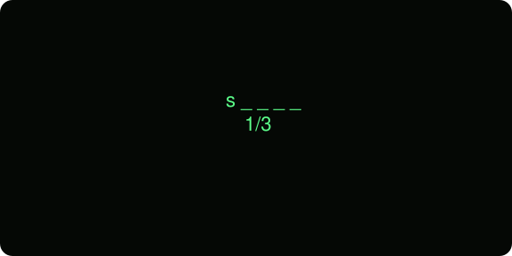
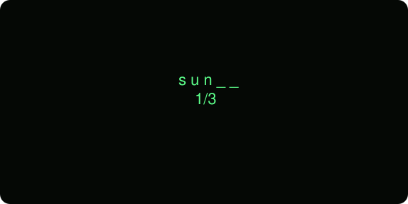
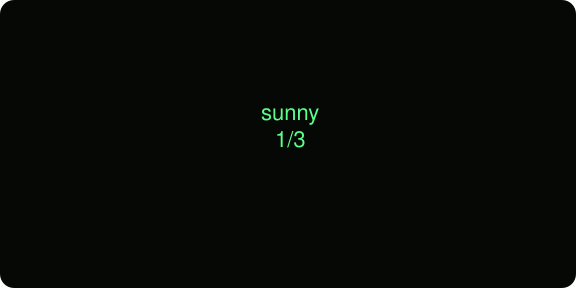
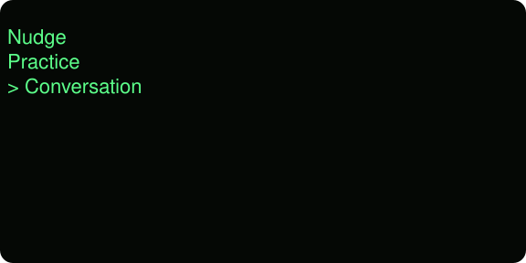
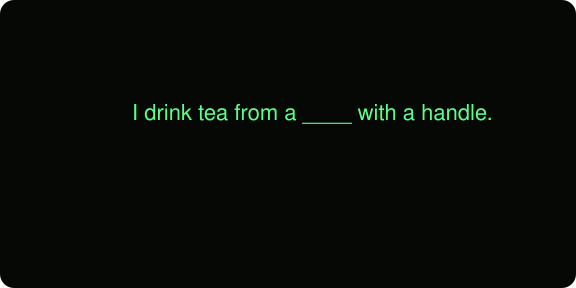
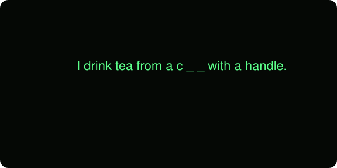
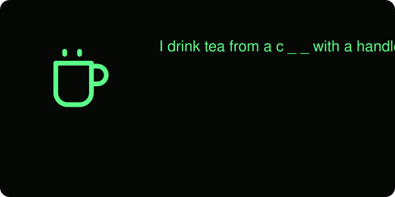
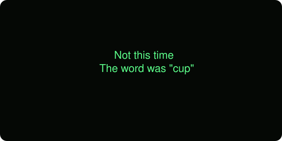
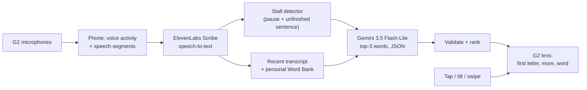

# Nudge

**The word is in there. Nudge helps it out.**

Nudge is a word-finding aid for people with **aphasia**, running on **Even Realities G2** display glasses. It listens to the conversation. When the wearer gets stuck on a word, it shows the *smallest* useful cue on the lens: the first letter, then more of the word, and only then the whole word. The wearer stays the one who says it.

Built in 24 hours at **LA Hacks 2026**. It runs on real G2 glasses, not only a phone mock-up.

<p align="center">
  
  
  
</p>
<p align="center"><sub>"No clouds, warm. It was, um…": the cue ladder on the G2's 576×288 display. Rendered from the app's own layout code; the word comes from a live device test.</sub></p>

---

## Why

About **2–4 million people in the US live with aphasia**, and there are roughly 100,000–180,000 new cases each year ([ASHA](https://www.asha.org/practice-portal/clinical-topics/aphasia/), [NIDCD](https://www.nidcd.nih.gov/health/statistics/quick-statistics-voice-speech-language)). People with aphasia often know exactly what they mean and still can't retrieve the word. The conversation stalls, the other person takes over, and confidence erodes.

Speech-language pathologists already use **graded cues** (a first sound, a written letter) to help a person *retrieve* a word rather than hand it to them. Retrieval practice tends to give more durable naming gains than repetition ([Middleton et al.](https://pmc.ncbi.nlm.nih.gov/articles/PMC10023178/)). But therapy happens in a clinic, and word-finding breakdowns happen at the kitchen table. Earlier research found glanceable, head-worn vocabulary prompts feasible for people with aphasia, and they helped keep partners engaged ([Williams et al., CHI 2015](http://www.cs.cmu.edu/~kmwillia/pdf/hwd_chi2015.pdf)).

Nudge puts that smallest clinical cue in front of the wearer at the moment the word gets stuck, without breaking eye contact and without speaking for them.

## What it does

The glasses open to two modes:

<p align="center"></p>

### Conversation: help during real speech

The display stays **blank** while you talk. When you stall ("…I forgot my, um"), Nudge predicts the word you're reaching for from the last few seconds of conversation and your personal word list, and shows the first letter.

| You do | Nudge does |
|---|---|
| Pause on a word ("…, um") | An automatic hint appears: `s _ _ _ _` |
| **Tap** the temple, any time | Asks for help right now: it finalizes what you just said and predicts |
| **Tap**, or **tilt your head sideways** | Reveals more: `s u n _ _`, then `sunny` |
| **Swipe**, or **look down / up** | Next or previous suggestion (top 3) |
| Say the word, or **double-tap** | The display goes blank again |
| Swipe while the display is blank | Pauses or resumes automatic hints |

Head gestures only act while a suggestion is showing, so normal head movement can't trigger anything else.

### Practice: structured naming

Practice is built on the cueing ladder speech-language pathologists use. Each wrong answer (or a tap) gives a little more help:

<p align="center">
  
  
  
  
</p>
<p align="center"><sub>Sentence → first letter → letter + picture → the answer, then the next word.</sub></p>

Your spoken answer is graded with real speech-to-text. A swipe skips a word, and the glasses show a summary at the end.

### Phone companion

The companion runs in the Even app on the phone. Its tabs:

- **Home:** start Practice or Conversation. Conversation has **Hint settings**: sensitivity (Calm / Balanced / Eager) and a pause switch.
- **Word Bank:** add the names, medications and places that matter to *this* person. They're stored on the phone and used both for prediction and as Practice words.
- **Preview:** mirrors the glasses.
- **Demo:** a clearly labelled scripted replay, so you can see the flow without glasses.

## How it works



- **Glasses ↔ phone:** the app is a TypeScript web app that runs in the Even phone app's WebView and draws on the glasses with the Even Hub SDK (`@evenrealities/even_hub_sdk`). Every screen is laid out for the 576×288 monochrome display with the G2 font metrics (`@evenrealities/pretext`).
- **Speech-to-text:** ElevenLabs **Scribe**, in short voice-segmented chunks. A tap finalizes the current chunk at once, so help doesn't wait for a pause. The phone gets single-use tokens from our server and never sees the API key.
- **Prediction:** Google **Gemini 3.5 Flash-Lite** behind our own `api/predict` proxy on Vercel. The prompt is few-shot, the output must match a JSON schema, and every answer is validated (malformed output and function words are dropped) before it reaches the lens. If the model is slow or down, the app falls back to a ranking from the personal word bank.
- **Stall detection:** silence after speech, plus a check of how the sentence ends (filler words, unfinished phrases). Sensitivity is adjustable, and hints can be paused.
- **Head gestures:** the G2's motion sensor at about 10 samples per second. Each gesture is calibrated when a suggestion appears and must be held about 0.4 s, so a quick nod doesn't count. The axes come from our own on-device measurements.

The full diagram is in [`docs/design/system-map.html`](docs/design/system-map.html) ([image](docs/design/system-map-diagram.png)).

## Measured, not claimed

These are small internal engineering tests, **not clinical evidence**. Each result links to its source in this repo.

| What | Result | Source |
|---|---|---|
| Gemini picks the intended word (31 team-written stalled sentences) | **31 / 31 in the top 3**, median **0.76 s**, 0 / 31 over our 1.2 s budget | [`spikes/stepfun/`](spikes/stepfun/FINDINGS.md) |
| Gemini vs. word-bank-only (25-case set) | top-3 **0.98** vs **0.60** | [`spikes/predictor/FINDINGS.md`](spikes/predictor/FINDINGS.md) |
| Alternative model (StepFun step-5-preview), same set | accurate, but median **6.6 s**: rejected | [`spikes/stepfun/FINDINGS.md`](spikes/stepfun/FINDINGS.md) |
| Live prediction through our server | **0.95–1.22 s** warm | [`docs/ORCH_STATE.md`](docs/ORCH_STATE.md) |
| Automatic hints, two-person conversation on the G2 | **3 of 3** planted stalls helped (`sunny`, `umbrella`, `gloves`; none of them in the word bank), **0 false hints**, 1.9–2.9 s from stall to letters | [`docs/BETA_RESULTS.md`](docs/BETA_RESULTS.md) |
| On the G2: hint speed | automatic hint about **1.5 s** after the stall when prefetched (about 3 s on the first call); tap → letters 1.7–1.9 s | [`docs/BETA_RESULTS.md`](docs/BETA_RESULTS.md) |
| Head gestures on the G2 | 4 / 4 sideways tilts revealed one step, 2 / 2 look-downs moved on, none fired off-screen | [`docs/BETA_RESULTS.md`](docs/BETA_RESULTS.md) |
| Automated tests | **839** (Vitest), on every PR in CI | `npm test` |

**What's real and what's scripted.** Glasses mic, speech-to-text, Gemini prediction, stall detection, gestures and Practice grading are all real and run on the G2. The phone **Demo** tab is a scripted replay, and the page says so. Telling the wearer's voice from the partner's by loudness is built and measured (the wearer is about 10–15 dB louder), but it is **off** in the judge build because it hasn't passed a device test.

## Privacy

- **No camera.** The G2 doesn't have one.
- **No audio is stored**, anywhere. Speech is transcribed and dropped.
- **API keys stay on the server.** The glasses and phone only ever get single-use tokens.
- **The Word Bank stays on the phone.**
- The display is **blank by default**. It shows something only when asked, or when a stall is detected, and automatic hints can be paused.

## Try it

**Without glasses** (Node 20+):

```bash
git clone https://github.com/SamVD/LA_AI_HACKS_26_TEAM && cd LA_AI_HACKS_26_TEAM
npm ci
npm run dev
```

Then open either page:

- `http://localhost:5173/src/phone/demo/`: the scripted judge demo. Tap **Play Step 2 (tap for help)**.
- `http://localhost:5173/src/phone/dev/?step3=1`: the phone companion with mock services.

**In the G2 simulator:** run `npm run dev` and, in a second terminal, `npm run simulate`.

**On the G2:** `npm run pack` builds `nudge.ehpk` from `app.json` (version **0.5.1** is the judge build). Upload it to [Even Hub](https://hub.evenrealities.com), then install it on the phone from **Me → Beta tester**.

## Repo map

| Path | What's there |
|---|---|
| `src/glasses/` | Renderer, layouts for 576×288, touchpad and head-tilt input, launcher, lifecycle |
| `src/modes/` | `step1` Practice, `step2` tap-for-help, `step3` Conversation (automatic hints, which wraps step2) |
| `src/audio/` | Glasses mic capture, voice-activity detection, Scribe client, chunked speech-to-text |
| `src/ai/` | Stall detector, Gemini predictor client (throttle, validation, fallback), keywords |
| `src/phone/` | Phone companion: Home, Word Bank, Preview, Demo |
| `src/content/` | Starter word bank (38 words) and line-art pictures |
| `api/` | Vercel functions: `stt/token` (single-use Scribe tokens), `predict` (Gemini proxy) |
| `spikes/` | Measurement experiments: device mic and motion sensor, speech-to-text, predictor, StepFun comparison |
| `docs/` | Devpost text, demo script, device test results, design, research, decisions |

## How we built it as a team

Four people and one pair of glasses. The QR dev mode didn't work on the device, so every glasses test meant packaging a build and uploading it to the Even Beta. We worked in **lanes** (glasses, AI, logic, UI) with an orchestrator:

- **Process:** every change went through a reviewed pull request into `integration`, with CI checking types, tests and file ownership. Over 140 PRs were merged in 24 hours.
- **Gates:** features shipped through three device-tested gates: **G1** Practice, **G2** tap-for-help, **G3** Conversation. The tags `v0.1-step1`, `v0.2-step2`, `v0.3-step3` and `v0.5.1` mark them.
- **Decisions:** design decisions D1–D27 are logged in [`PLAN.md`](PLAN.md) §13.
- **Records:** task cards are in [`TASKS.md`](TASKS.md), and the final project state is in [`docs/ORCH_STATE.md`](docs/ORCH_STATE.md).

Developer setup and the rules we followed: [`CONTRIBUTING.md`](CONTRIBUTING.md).

| Name | Role |
|---|---|
| Aarav Jain | Orchestration: architecture, reviews, integration, submission |
| Samuel Vander Dussen | AI: speech-to-text hosting, Gemini predictor, stall detection |
| Sarah Dias | Glasses: renderer, mic, every on-device test |
| Juan Li Chen | UI and logic: phone companion, Practice, matcher, gestures |

## What's next

- **Co-design:** home testing with people with aphasia and speech-language pathologists. Check gesture accessibility, false hints and setup burden.
- **Reliability:** noisy rooms, telling the wearer from the partner (shorter audio chunks), and offline fallback.
- **Clinical pilot:** use the cue level each word needed (one letter, half the word, the whole word) as a measure of real-world word retrieval between therapy visits.

> Nudge doesn't speak over the user. It gives the smallest possible hint at the moment it's needed, so the conversation and the voice stay the user's own.
